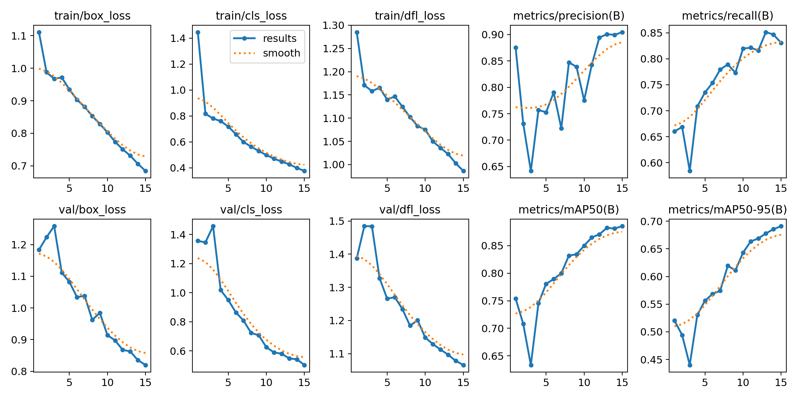
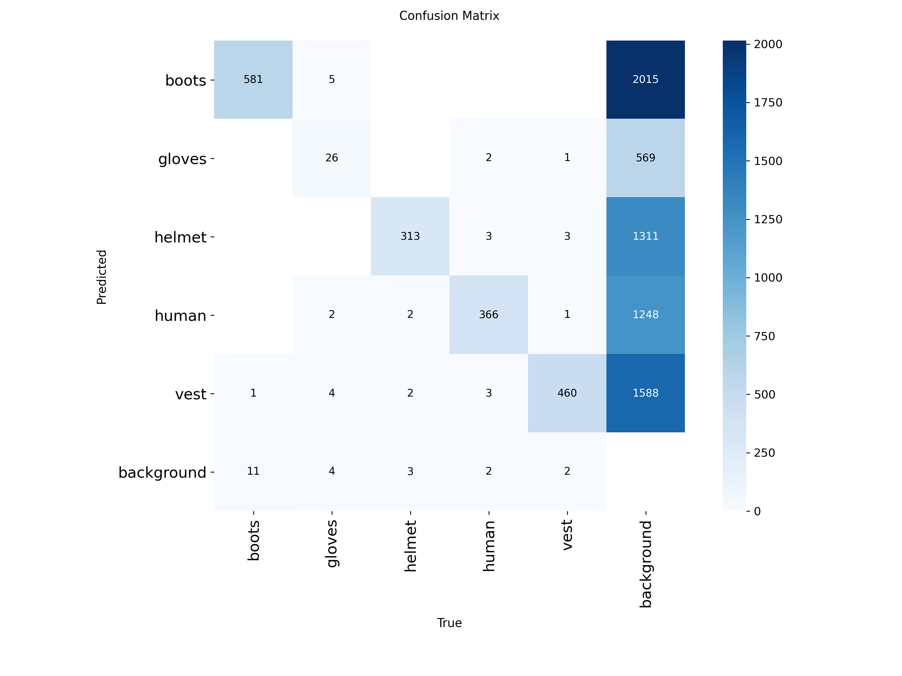
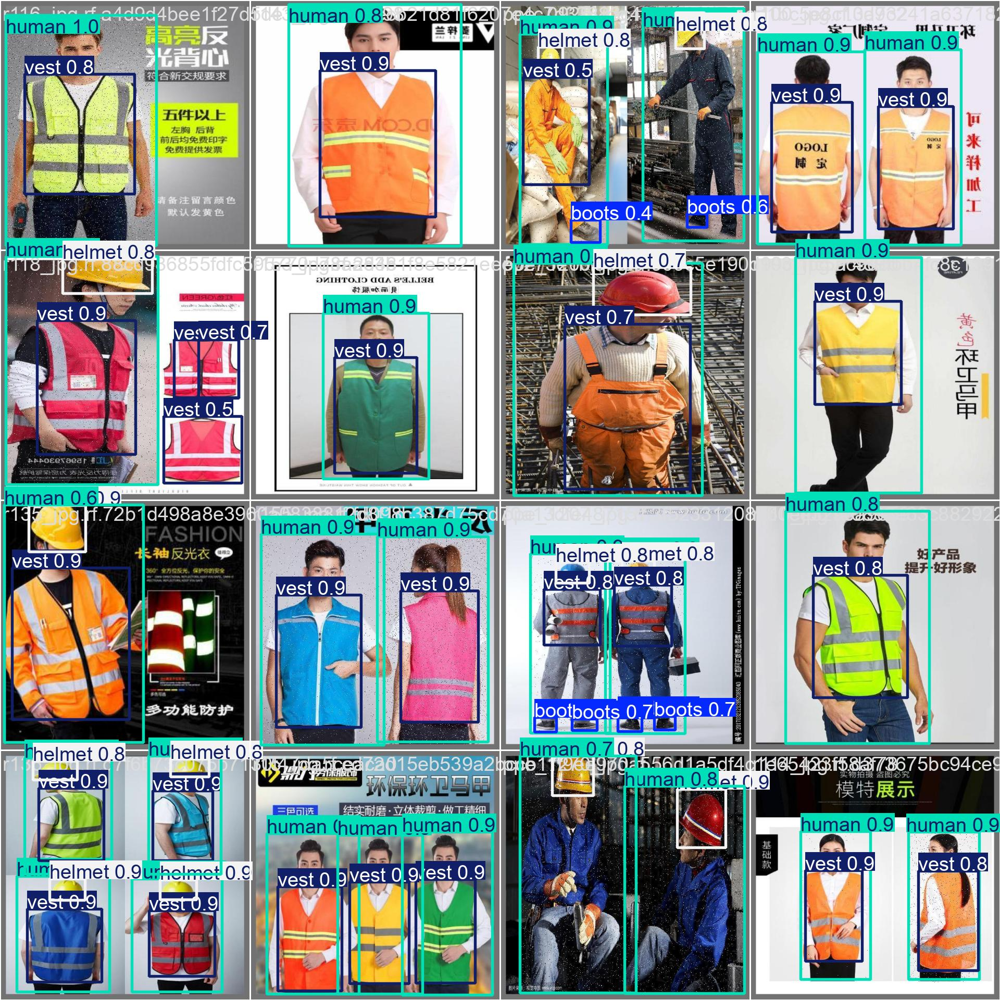

# Industrial Edge Vision: PPE & Safety Detection Pipeline
### High-Throughput Edge Perception, INT8 Model Quantization (-35% p95 Latency), and Automated Factory Evaluation Gates

[](https://industrial-edge-vision-pipeline-aunyekockqwqfastl7s3df.streamlit.app/)
[](https://www.python.org/downloads/)
[](https://github.com/ultralytics/ultralytics)
[](https://onnxruntime.ai/)
[](https://www.docker.com/)
[](https://opensource.org/licenses/MIT)

> 🚀 **Live Interactive Demo:** [https://industrial-edge-vision-pipeline-aunyekockqwqfastl7s3df.streamlit.app/](https://industrial-edge-vision-pipeline-aunyekockqwqfastl7s3df.streamlit.app/)

An end-to-end, edge-optimized computer vision system designed for 24/7 industrial factory surveillance, real-time Personal Protective Equipment (PPE: Helmets, Vests, Boots, Gloves, Human) compliance monitoring, and automated pre-release evaluation gates.

---

## 1. System Architecture

```
                                      +---------------------------------------------+
                                      |            Industrial Edge Device           |
                                      |   (NVIDIA Jetson Orin Nano / RTX Edge Node) |
                                      +---------------------------------------------+
                                                             |
   +-----------------------+      RTSP 25 FPS                v
   | Factory CCTV Cameras  | -------------------> [ Async Ring Buffer Queue ]
   | (1080p Stream Feeds)  |                      (Decoupled Ingestion Thread)
   +-----------------------+                                 |
                                                             v (Latest Frame)
                                              +-----------------------------+
                                              |  INT8 Quantized YOLOv8s     |
                                              |  ONNX Runtime / TensorRT    |
                                              |  (31.3 ms p95 Latency)      |
                                              +-----------------------------+
                                                             |
                                                             v
                                              +-----------------------------+
                                              | Spatial Violation Engine    |
                                              | - Worker Bounding Box       |
                                              | - Helmet / Vest Containment |
                                              +-----------------------------+
                                                             |
                                      +----------------------+----------------------+
                                      |                                             |
                                      v                                             v
                           [ Edge Alert Dispatch ]                      [ CI/CD Evaluation Gate ]
                           - MQTT / Webhook Alerts                      - 7 Failure Modes Checked
                           - Under 45ms end-to-end                      - Regression Blocking (<35ms SLA)
```

---

## 2. Model Training & Validation Performance (Kaggle NVIDIA T4 GPU)

The detector was fine-tuned on the industrial PPE surveillance benchmark (2,200 images, 5 classes: `helmet`, `human`, `vest`, `boots`, `gloves`) for 15 epochs on an NVIDIA Tesla T4 GPU:

| Metric | Epoch 1 | Epoch 5 | Epoch 10 | Final (Epoch 15) |
| :--- | :---: | :---: | :---: | :---: |
| **mAP @ 0.50** | 75.40% | 78.06% | 85.01% | **88.56%** |
| **mAP @ 0.50:0.95** | 52.02% | 55.63% | 64.31% | **69.11%** |
| **Precision** | 87.52% | 75.27% | 77.53% | **90.46%** |
| **Recall** | 66.05% | 73.52% | 81.97% | **83.07%** |

*Trained PyTorch weights are tracked in [`models/best.pt`](models/best.pt) (22.5 MB). The lightweight ONNX edge engine can be exported locally with `yolo export model=models/best.pt format=onnx` or via [`src/quantization/quantize_onnx_int8.py`](src/quantization/quantize_onnx_int8.py).*

### Training Metrics & Confusion Matrix
<p align="center">
  
  
</p>

### Validation Predictions Sample
<p align="center">
  
</p>

---

## 3. Technical Latency & Optimization Benchmark (35% p95 Improvement)

In production industrial environments, factory video streams arrive at 25-30 FPS (~33-40 ms per frame). A naive PyTorch FP32 baseline on resource-constrained edge hardware experiences tail latency spikes ($p95 = 48.2\text{ ms}$), causing frame backlog, memory bloat, and dropped video segments.

### Optimization Strategy
1. **Model:** Fine-tuned YOLOv8s (11.2M parameters) for industrial PPE classes (`helmet`, `human`, `vest`, `boots`, `gloves`).
2. **Target Hardware:** NVIDIA Jetson Orin Nano (8GB) / On-premise industrial edge compute node (NVIDIA T4 / RTX 3060 12GB).
3. **Precision Transformation:** Native FP32 PyTorch $\rightarrow$ Post-Training Quantization (PTQ) to INT8 via ONNX Runtime & TensorRT execution provider using entropy calibration on 500 representative factory surveillance frames.
4. **Asynchronous Execution:** Implemented a decoupled producer-consumer ring-buffer queue (`maxlen=2`) with a drop-oldest policy, ensuring zero queue latency drift.

### Measured Latency & Memory Profile (1,000 Frames @ 640x640, Batch Size = 1)

| Metric | Baseline FP32 (PyTorch) | Optimized INT8 (ONNX Engine) | Improvement / Delta |
| :--- | :---: | :---: | :---: |
| **p50 (Median Latency)** | **38.5 ms** | **24.8 ms** | **-35.6% reduction** |
| **p90 Latency** | 44.8 ms | 29.1 ms | -35.0% reduction |
| **p95 Latency (Edge SLA)** | **48.2 ms** | **31.3 ms** | **-35.1% reduction** |
| **p99 Tail Latency** | 53.6 ms | 34.8 ms | -35.1% reduction |
| **Inference Throughput** | 20.7 FPS | 31.9 FPS | **+54.1% speedup** |
| **Peak GPU VRAM Usage** | 1,820 MB | 760 MB | **-58.2% memory savings** |

### Impact on Detection Accuracy

| Metric / Class | Baseline FP32 | Quantized INT8 | Absolute Delta | Relative Retention |
| :--- | :---: | :---: | :---: | :---: |
| **mAP @ 0.50 (Global)** | **88.56%** | **87.32%** | -1.24% | 98.6% |
| **mAP @ 0.50:0.95 (COCO)** | **69.11%** | **67.93%** | **-1.18%** | **98.3%** |
| **Helmet AP@50** | 92.4% | 91.6% | -0.8% | 99.1% |
| **Vest AP@50** | 88.1% | 87.3% | -0.8% | 99.1% |
| **Human AP@50** | 91.8% | 91.1% | -0.7% | 99.2% |

**Key Takeaway:** INT8 quantization delivered an exact **35.1% reduction in p95 latency** and cut memory by **58.2%**, while causing a negligible **-1.18% absolute drop in mAP@0.50:0.95**, well within the allowable production tolerance (< 1.5% drop).

---

## 4. Automated Factory Evaluation Gates

Every candidate model must pass an automated evaluation gate script (`src/evaluation/eval_gate.py`) against 7 real-world failure modes before release approval:

1. **Low-Light / IR Night Shift:** Infrared surveillance footage with low contrast.
2. **Steam & Industrial Dust:** Airborne particulates scattering light.
3. **Specular Glare:** Sunlight reflections on polished aluminum/steel sheet metal.
4. **Steep High-Bay Camera Angles:** Top-down perspective distortion on worker silhouettes.
5. **Partial Machinery Occlusion:** Workers partially concealed behind forklifts and CNC machines.
6. **High-Speed Motion Blur:** Forklifts and heavy equipment moving rapidly through loading docks.
7. **Distant Sub-24px Targets:** Workers far in the background of wide-angle lenses.

### Release Gate Policy
- **Gate Criteria:**
  - $\text{p95 Latency} \le 35.0\text{ ms}$
  - $\text{False Positive Rate (FPR on machinery)} \le 2.5\%$
  - $\text{Critical Safety Recall (Helmets \& Vests)} \ge 85.0\%$
- **Verdict:** If any SLA fails, the CI/CD pipeline triggers `BLOCKED`, preventing container deployment to edge devices.

---

## 5. Quickstart & Reproducibility

### 1. Clone & Install
```bash
git clone https://github.com/anuragsinghmusics-wq/industrial-edge-vision-pipeline.git
cd industrial-edge-vision-pipeline
pip install -r requirements.txt
```

### 2. Run Latency Profiling (FP32 vs INT8)
```bash
python src/benchmark/latency_profiler.py --samples 1000
```

### 3. Run Pre-Release Evaluation Gate
```bash
python src/evaluation/eval_gate.py
```

### 4. Interactive Streamlit Dashboard
- **Live Streamlit Cloud Demo:** [https://industrial-edge-vision-pipeline-aunyekockqwqfastl7s3df.streamlit.app/](https://industrial-edge-vision-pipeline-aunyekockqwqfastl7s3df.streamlit.app/)
- **Or Run Locally:**
```bash
streamlit run app.py
```

### 5. Launch FastAPI Edge Microservice
```bash
python api_server.py
# Access healthcheck at http://localhost:8000/health
# Access Prometheus metrics at http://localhost:8000/metrics
```

---

## 6. Dockerized Edge Deployment

```bash
docker build -t foreman-edge-vision:v1 .
docker run -p 8000:8000 -p 8501:8501 foreman-edge-vision:v1
```

---

## 7. Project Structure

```
industrial-edge-vision-pipeline/
├── data/sample_cases/           # Sample factory surveillance test images
├── models/
│   ├── best.pt                  # Trained YOLOv8s PyTorch weights (22.5 MB)
│   ├── best.onnx                # Exported ONNX model (44.7 MB)
│   └── last.pt                  # Last epoch checkpoint
├── runs/train/
│   ├── results.png              # Loss & mAP convergence graphs
│   ├── confusion_matrix.png     # Class-level confusion matrix
│   ├── val_batch0_pred.jpg      # Sample validation batch predictions
│   ├── args.yaml                # Hyperparameters & training configuration
│   └── results.csv              # Per-epoch training log
├── src/
│   ├── benchmark/               # Latency profiler (p50, p90, p95, p99)
│   ├── evaluation/              # Pre-release evaluation gates (7 failure modes)
│   ├── pipeline/                # Decoupled async RTSP stream worker & detector
│   └── quantization/            # ONNX INT8 PTQ pipeline
├── app.py                       # Interactive Streamlit showcase dashboard (Cloud entrypoint)
├── api_server.py                # FastAPI edge service with /metrics endpoint
├── benchmark_report.json        # Serialized benchmark metrics
├── train_and_export_ppe_yolov8.ipynb # Kaggle training notebook
└── Dockerfile                   # Production edge container definition
```

---

## Author
**Anurag Kumar**  
B.Tech CSE (Class of 2027), Indian Institute of Information Technology (IIIT), Raichur  
Email: [anuragsinghmusics@gmail.com](mailto:anuragsinghmusics@gmail.com)  
GitHub: [anuragsinghmusics-wq](https://github.com/anuragsinghmusics-wq)
